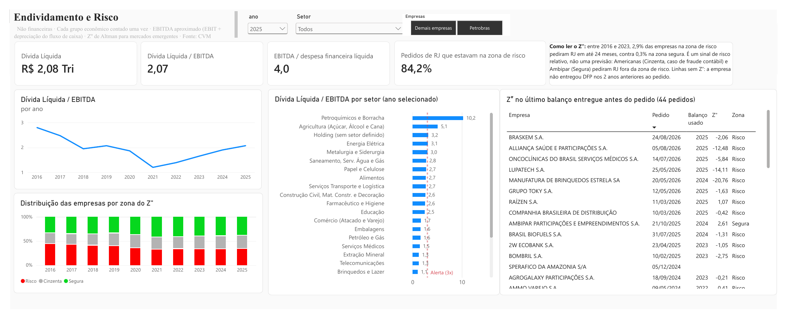
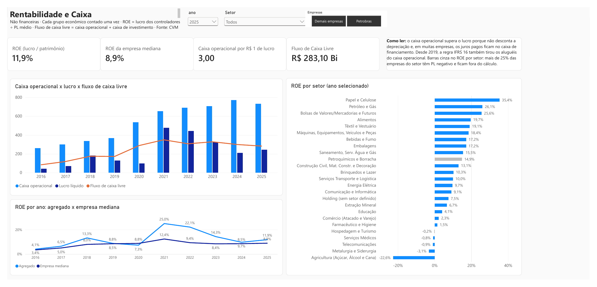
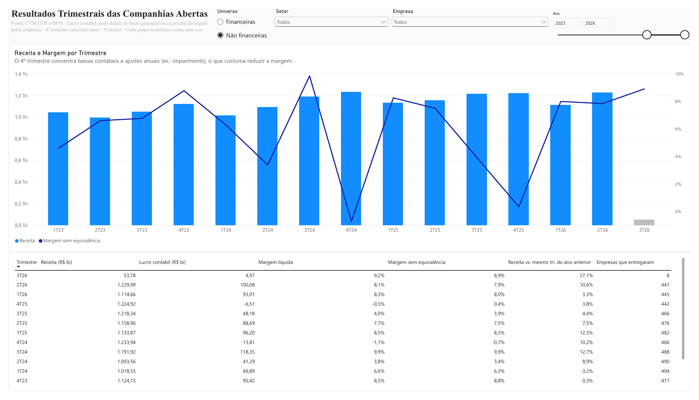

# Painel Fundamentalista B3

Saúde financeira das empresas abertas brasileiras, de 2016 a 2025, a partir dos
dados públicos da CVM e do Banco Central: **rentabilidade, endividamento, risco de
crédito e crescimento, por setor e por empresa**, com cada grupo econômico contado
uma única vez.

O projeto vai do dado bruto ao painel: Python baixa e organiza os arquivos da CVM,
o DuckDB monta as tabelas de análise com dezenas de conferências automáticas, e o
Power BI e um relatório Excel mostram o resultado.

**Nesta página:** o [painel em PDF](painel_fundamentalista_b3.pdf) e o
[relatório Excel](analise_setorial.xlsx), com o resumo por setor e ano.

> **Aviso:** projeto de estudo e portfólio. Não é recomendação de investimento.

---

## As perguntas que o painel responde

| Pergunta | Onde |
|---|---|
| Quais setores estão mais alavancados e quem fica apertado com os juros? | Endividamento e Risco |
| Que empresas mostram sinais de risco de crédito antes de pedir recuperação judicial? | Endividamento e Risco · Recuperação Judicial |
| Quanto as empresas rendem sobre o capital dos sócios, e quanto do lucro vira caixa? | Rentabilidade e Caixa |
| O crescimento da receita é das empresas ou da entrada de novas empresas na bolsa (IPOs)? | Crescimento |
| Quanto do lucro total depende da Petrobras e das 10 maiores? | Visão Geral |
| Como estão os bancos, separados das demais empresas? | Bancos e Financeiras |
| Como foi o último trimestre, empresa a empresa? | Resultados Trimestrais · Ficha da Empresa |

## Principais leituras

Valores das empresas não financeiras, salvo indicação. Lucro contábil, em reais nominais quando não se diz "real".

**O total da bolsa é concentrado.**
Em 2025, as empresas não financeiras somaram **R$ 4,64 tri** de receita e margem líquida de **5,3%**. A Petrobras respondeu por **44%** do lucro, e as 10 maiores, por **79%**. Sem a Petrobras, a margem cai para **3,4%**. A margem da empresa mediana foi de **5,0%**.

**Boa parte do crescimento vem da composição, não das empresas.**
De 2024 para 2025, a receita total passou de R$ 4.489 bi para R$ 4.640 bi. As empresas presentes nos dois anos cresceram R$ 347 bi (**+8,2% nominal, +3,0% acima do IPCA**). O resto veio de entradas (+R$ 37 bi), saídas (−R$ 214 bi) e empresas que ainda não entregaram a DFP (−R$ 19 bi). O crescimento real da mesma base oscila muito de ano para ano: **+24,3% em 2021** (commodities) e **−4,7% em 2023**.

**A alavancagem voltou a subir depois de 2021.**
A dívida líquida sobre o EBITDA caiu de cerca de **2,8x (2016)** para **1,2x (2021)** e voltou a **1,90x (2024)** e **2,07x (2025)**. Em 2024, o EBITDA cobria **2,8 vezes** a despesa financeira líquida. A parcela de empresas na zona de risco do Z″ foi de cerca de **43% (2016)**, **32% (2021)** e **35% (2023–2025)**.

**O Z″ funciona como triagem, não como previsão.**
De 38 pedidos de recuperação judicial com balanço disponível, **32 (84%)** estavam na zona de risco no último balanço entregue *antes* do pedido. Entre todas as empresas, essa parcela é de 36%. Em 24 meses, pediram recuperação **2,9%** das empresas na zona de risco, contra **0,3%** na zona segura. Mas a maioria das empresas na zona de risco não quebra, e houve falhas importantes: Americanas (zona cinzenta, caso de fraude contábil) e Ambipar (zona segura).

**O ROE alto de 2021 foi das gigantes.**
O ROE agregado chegou a **25,0%** em 2021, enquanto o da empresa mediana ficou em **12,4%**. Desde 2018, a mediana fica entre cerca de 7% e 12%. Em 2024, tanto o agregado (**9,7%**) quanto a mediana (**8,5%**) ficaram abaixo da Selic do ano. O caixa operacional foi **3,65 vezes** o lucro, e o fluxo de caixa livre, **R$ 300 bi**.

**Bancos: rentabilidade estável e líderes conhecidos.**
O ROE agregado das financeiras ficou entre **10,6% (2020, pandemia)** e **16,5% (2022)**. Em 2024: Itaú **20,5%**, BTG **19,2%**, Banco do Brasil **15,1%**, Santander **11,4%** e Bradesco **10,3%**. O lucro do setor (sem equivalência patrimonial) foi de **R$ 66 bi em 2016** para **R$ 127 bi em 2025**.

---

## O painel

| | |
|---|---|
|  **Visão Geral** |  **Crescimento** |
|  **Rentabilidade e Caixa** |  **Bancos e Financeiras** |
|  **Recuperação Judicial** |  **Resultados Trimestrais** |
|  **Ficha da Empresa** |  **Endividamento e Risco** |

## Páginas do painel

| Página | Conteúdo |
|---|---|
| Visão Geral | Receita, lucro e margem por setor e ano; peso da Petrobras e das 10 maiores; valores nominais ou corrigidos pelo IPCA |
| Resultados Trimestrais | Receita, lucro e margem por trimestre, com o 4º trimestre calculado e o trimestre ainda incompleto destacado |
| Ficha da Empresa | Histórico de uma empresa e a cadeia de controle que define se ela conta no total |
| Validação | Conferências dos números do painel |
| Recuperação Judicial | Pedidos de recuperação judicial e extrajudicial e falências desde 2016, por setor e situação |
| Crescimento | Ponte da receita: mesma base, entradas, saídas e empresas sem DFP; crescimento nominal e real |
| Endividamento e Risco | Dívida líquida, Dívida/EBITDA, cobertura de juros, zonas do Z″ e o Z″ antes de cada pedido de recuperação |
| Rentabilidade e Caixa | ROE agregado e da empresa mediana, ROE por setor, caixa operacional × lucro × fluxo de caixa livre |
| Bancos e Financeiras | Lucro, ROE agregado e mediano, e as 10 financeiras com maior lucro |

O [relatório Excel](analise_setorial.xlsx) traz o resumo por setor e ano com as mesmas regras do painel, a base por empresa e um dicionário de colunas.

---

## Método

### Fontes

| Fonte | O que traz |
|---|---|
| CVM: DFP | Demonstrações anuais: balanço, resultado e fluxo de caixa |
| CVM: ITR | Demonstrações trimestrais |
| CVM: FRE | Formulário de Referência: acionistas e participações (para a regra de controle) |
| CVM: IPE | Fatos relevantes e comunicados (para datar pedidos de recuperação judicial) |
| Banco Central: SGS 433 | IPCA mensal (correção pela inflação) |

### Cada grupo econômico contado uma vez

Somar todas as empresas listadas conta o mesmo grupo várias vezes: a Cemig e a
Cemig Distribuição, a Gerdau e a Metalúrgica Gerdau, a Petrobras e a Vibra
quando era controlada. Uma regra em três camadas resolve isso:

1. **Regra automática (FRE):** uma empresa sai do total quando outra empresa do painel tem **mais de 50%** das ações ordinárias dela no mesmo ano, subindo a cadeia de controle.
2. **Mapeamento manual**, revisado empresa a empresa: holdings com receitas idênticas às da controlada, controladoras estrangeiras e casos que o FRE não mostra. Cada linha tem a justificativa.
3. **Contenção por ano:** pontos cegos de anos sem FRE entregue (Vibra 2016, Sendas 2019, Éxito 2021, BRF a partir de 2025).

Em 2025, sem nenhuma exclusão, a soma daria R$ 6,0 tri de receita. Com a regra, **R$ 4,64 tri**.

### Outras regras

- **Financeiras separadas.** Bancos, seguradoras e afins têm outra estrutura de resultado e ficam fora dos totais das demais empresas, com página própria. O patrimônio dos bancos é lido no layout de instituição financeira (contas 2.05, 2.07 ou 2.08).
- **Lucro contábil.** O lucro publicado na DFP, sem ajustes gerenciais ou "recorrentes".
- **4º trimestre calculado:** DFP do ano menos a soma dos três ITRs. Quando o resultado sai incoerente (receita negativa), o trimestre é descartado.
- **Mesma base:** a variação da receita é separada entre empresas presentes nos dois anos, entradas, saídas e empresas que ainda não entregaram a DFP.
- **IPCA:** valores corrigidos para reais do mês mais recente da série.
- **ROE:** lucro dos controladores ÷ patrimônio líquido médio dos controladores, só com PL médio positivo. Quando mais de 25% das empresas de um setor ficam de fora por PL negativo, a barra do setor aparece em cinza.
- **Z″ de Altman para mercados emergentes:** 6,56·X1 + 3,26·X2 + 6,72·X3 + 1,05·X4. Zonas: acima de 2,60 segura, de 1,10 a 2,60 cinzenta, abaixo de 1,10 risco. Financeiras ficam fora.
- **Validação do Z″ sem olhar o futuro:** para cada pedido de recuperação, usa-se o último balanço **entregue à CVM antes da data do pedido**, e não o do ano do pedido.

### Problemas de dados encontrados e corrigidos

As conferências por setor revelaram erros que o total escondia:

| Problema | Efeito antes da correção |
|---|---|
| Muitas empresas informam o lucro dos controladores (3.11.01) **zerado** e põem o lucro só na conta do período | Até 72 empresas por ano com ROE 0% (Sabesp, Klabin, TIM…); a mediana do ROE de 2024 caía de 8,5% para 5,5% |
| O patrimônio dos bancos fica em outro código de conta | ROE dos bancos vazio |
| O Santander Espanha entrava no total das financeiras | Lucro global do grupo somado ao do Santander Brasil em 2016–2017 (R$ 27 bi a mais) |
| O layout de banco aplicado a holdings não financeiras | PL perto de zero e ROE de até 74.950% em uma holding |
| Anos sem FRE entregue | Controladas de grandes grupos (Vibra, Sendas, Éxito, BRF) contadas junto com a controladora |

O pipeline imprime mais de 50 conferências a cada execução (somas, casos conhecidos, quantidades que precisam ser zero), para que um erro desse tipo apareça logo.

### Limitações

- **EBITDA aproximado:** EBIT mais depreciação e amortização do fluxo de caixa. Lucros retidos aproximados por reservas de lucro e lucros acumulados.
- **Despesa financeira com câmbio:** a conta da CVM inclui variação cambial, o que distorce a cobertura de juros de empresas com dívida em dólar nos anos de câmbio forte.
- **Composição:** "mesma base" não é crescimento orgânico. Inclui aquisições, venda de ativos e câmbio.
- **Empresas estrangeiras** com BDR (Dufry, Éxito, Aura, Biotoscana…) contam pelo consolidado global, que inclui receita de fora do Brasil.
- **Trimestres:** em cerca de 1% dos casos o ITR só tem a demonstração individual enquanto a DFP usa a consolidada. Seis diferenças residuais entre a soma dos trimestres e a DFP (empresas no ano do IPO). O trimestre mais recente fica parcial até o fim do prazo de entrega.
- **Z″** sem valor para pedidos de 2016 e início de 2017 (não há balanços de 2015 na janela) e para empresas que não entregaram DFP nos dois anos anteriores ao pedido.
- **Atualização:** a CVM atualiza os arquivos semanalmente. Os números mudam quando empresas reapresentam demonstrações.
- **Casos residuais:** três empresas-ano (2016 e 2020) com lucro dos controladores zerado no balanço individual.

---

## Tecnologia

| Etapa | Ferramenta |
|---|---|
| Coleta e carga | Python (download dos arquivos da CVM e do Banco Central) |
| Modelagem e conferências | DuckDB (SQL), com mais de 50 conferências automáticas a cada execução |
| Testes | pytest |
| Visualização | Power BI (9 páginas) e relatório Excel gerado pelo pipeline |

O pipeline completo é executado com um único comando: baixa as fontes, recria as tabelas de análise, roda as conferências e atualiza o painel e o relatório.

**O código-fonte está em repositório privado** e pode ser apresentado mediante solicitação.

---

## Próximos passos

- **Screener de qualidade e risco:** filtros combinando ROE estável, caixa acima do lucro, dívida baixa e sinais de alerta (Z″ caindo, dívida subindo).
- **Valuation:** cotações históricas da B3 para P/L, EV/EBITDA e dividend yield.
- **Juros e setores:** custo efetivo da dívida e cobertura de juros por setor ao longo dos ciclos da Selic.
- **Empresas × economia:** crescimento real das empresas comparado ao do PIB.

---

Autor: Kevin Estanislau
