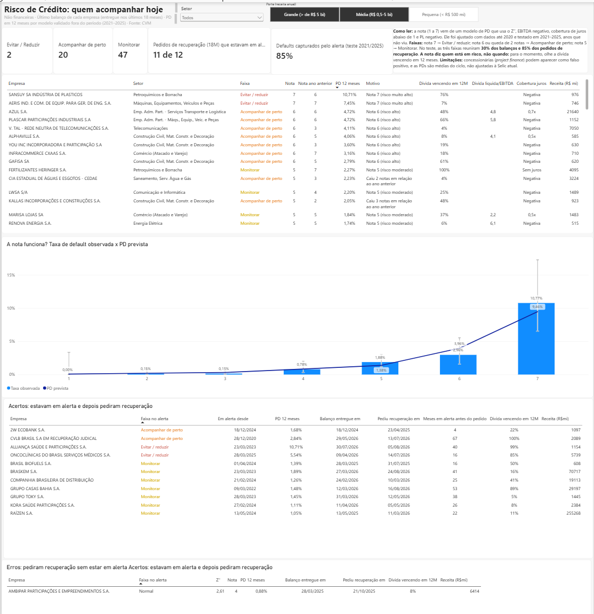
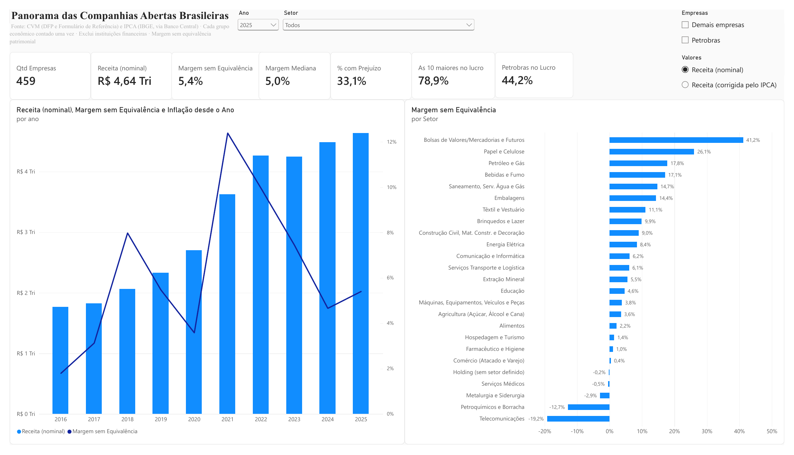
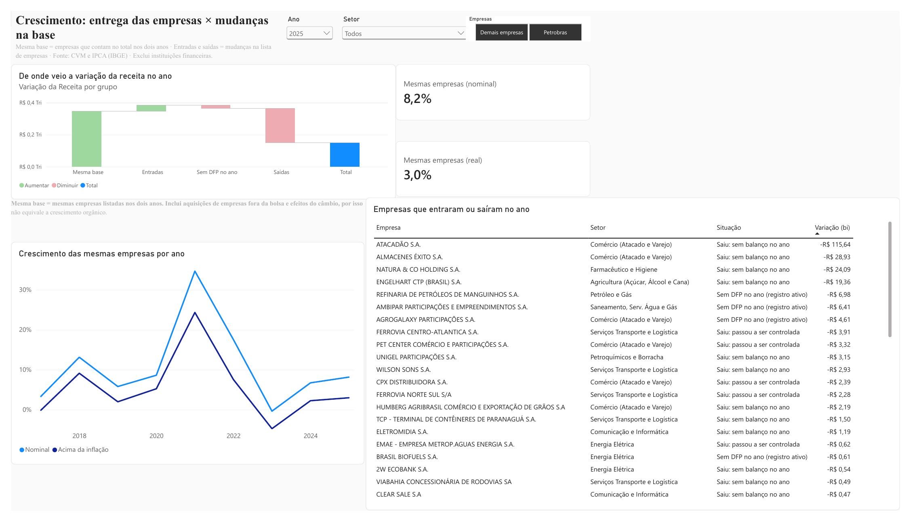
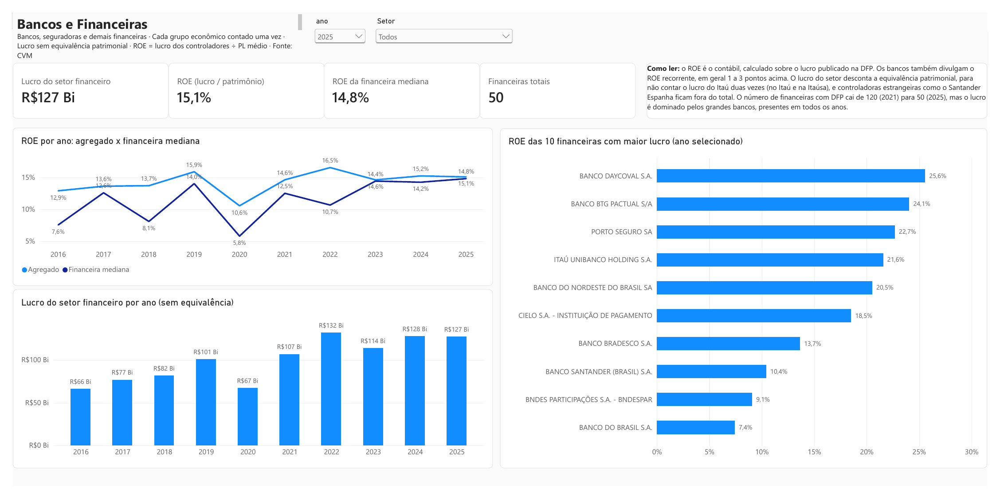
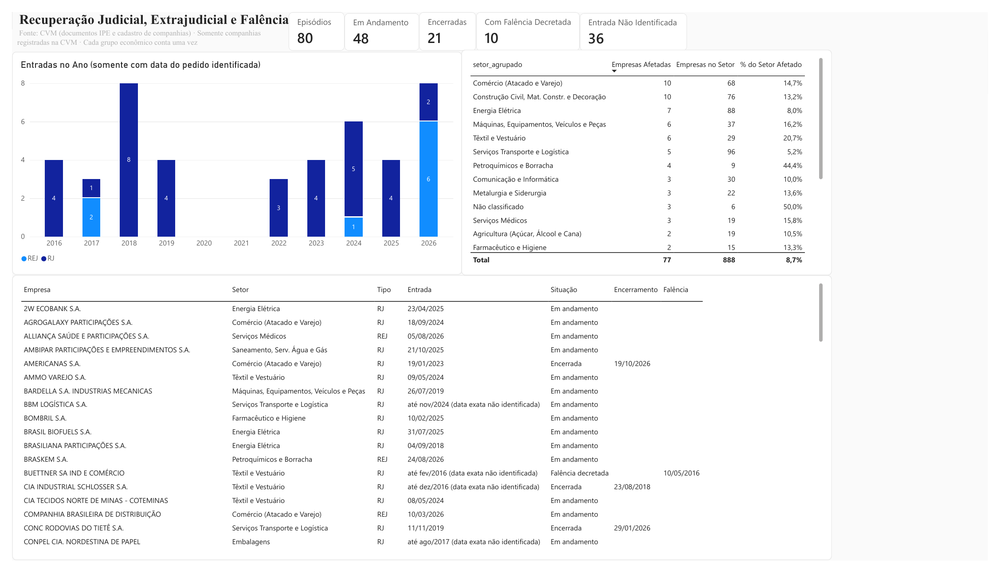
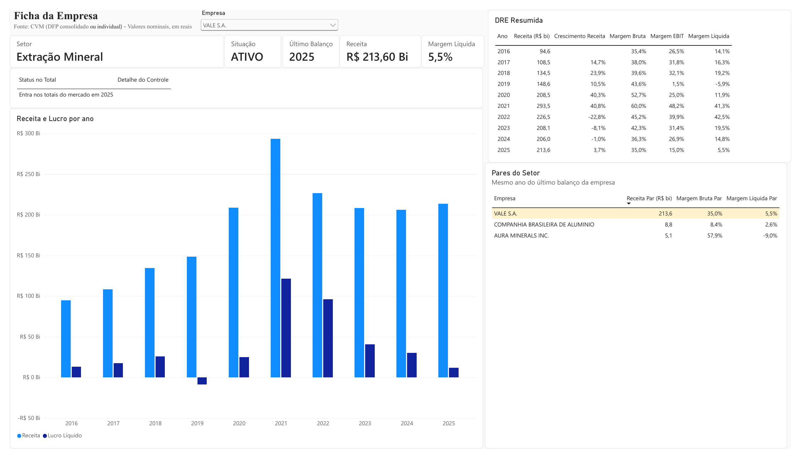

# Painel Fundamentalista B3

Saúde financeira das empresas abertas brasileiras, de 2016 a 2025, a partir dos
dados públicos da CVM e do Banco Central: **rentabilidade, endividamento, risco de
crédito e crescimento, por setor e por empresa**, com cada grupo econômico contado
uma única vez.

O projeto vai do dado bruto à decisão: Python baixa e organiza os arquivos da CVM,
o DuckDB monta as tabelas de análise com dezenas de conferências automáticas, um
**modelo de risco de crédito validado fora do período** dá a cada empresa uma
probabilidade de pedir recuperação em 12 meses, e o Power BI e um relatório Excel
mostram o resultado.

**Nesta página:** o [painel em PDF](painel_fundamentalista_b3.pdf) e o
[relatório Excel](analise_setorial.xlsx), com o resumo por setor e ano.

> **Aviso:** projeto de estudo e portfólio. Não é recomendação de investimento.

---

## As perguntas que o painel responde

| Pergunta | Onde |
|---|---|
| **Quais empresas um gestor de crédito deve acompanhar hoje, e com que prioridade?** | **Risco de Crédito** |
| **A probabilidade de default do modelo bate com o que aconteceu?** | **Risco de Crédito** |
| Quais setores estão mais alavancados e quem fica apertado com os juros? | Endividamento e Risco |
| Que empresas mostram sinais de risco de crédito antes de pedir recuperação judicial? | Risco de Crédito · Endividamento e Risco · Recuperação Judicial |
| Quanto as empresas rendem sobre o capital dos sócios, e quanto do lucro vira caixa? | Rentabilidade e Caixa |
| O crescimento da receita é das empresas ou da entrada de novas empresas na bolsa (IPOs)? | Crescimento |
| Quanto do lucro total depende da Petrobras e das 10 maiores? | Visão Geral |
| Como estão os bancos, separados das demais empresas? | Bancos e Financeiras |
| Como foi o último trimestre, empresa a empresa? | Resultados Trimestrais · Ficha da Empresa |

## Principais leituras

Valores das empresas não financeiras, salvo indicação. Lucro contábil, em reais nominais quando não se diz "real".

**O modelo de crédito separa o risco em anos que ele não viu.**
Ajustado com balanços entregues até 2020 e testado em 2021–2025, o modelo teve AUC de **0,841**, contra **0,817** do Z″ sozinho. As três faixas de alerta reuniram cerca de **29% dos balanços** e **85% dos pedidos de recuperação** do período de teste. Só a faixa mais grave (**Evitar / reduzir**, nota 7) reuniu **6% dos balanços** e **30% dos pedidos**. Na escala de notas, a nota 7 previu **9,5%** de pedidos em 12 meses, e aconteceram **10,8%**.

**Na prática, o alerta veio cedo.**
Dos **15 pedidos de recuperação** de companhias abertas não financeiras entre abril de 2025 e agosto de 2026, **14** estavam em alerta no último balanço entregue antes do pedido, e **13** estavam em alerta havia **mais de 12 meses**: Casas Bahia desde 2022 (**53 meses**), Braskem desde 2023 (**41 meses**), GPA desde 2024 (**25 meses**). O único erro foi a **Ambipar**, com Z″ de 2,61 (zona segura) e nota 4, numa crise que, segundo o noticiado, veio de um contrato de derivativos e do vencimento antecipado de dívidas em poucas semanas. Parte desses balanços foi usada no ajuste do modelo final: a prova independente é o período de teste, acima.

**Hoje, 134 empresas estão em alerta.**
Entre as 468 não financeiras com balanço entregue nos últimos 18 meses: **12** em Evitar / reduzir, **45** em Acompanhar de perto e **77** em Monitorar. Muitas das notas 7 são empresas pequenas, já reestruturadas e sem dívida negociável relevante; o filtro de porte do painel deixa só as que cabem numa carteira de crédito.

**O total da bolsa é concentrado.**
Em 2025, as empresas não financeiras somaram **R$ 4,64 tri** de receita e margem líquida de **5,3%**. A Petrobras respondeu por **44%** do lucro, e as 10 maiores, por **79%**. Sem a Petrobras, a margem cai para **3,4%**. A margem da empresa mediana foi de **5,0%**.

**Boa parte do crescimento vem da composição, não das empresas.**
De 2024 para 2025, a receita total passou de R$ 4.489 bi para R$ 4.640 bi. As empresas presentes nos dois anos cresceram R$ 347 bi (**+8,2% nominal, +3,0% acima do IPCA**). O resto veio de entradas (+R$ 37 bi), saídas (−R$ 214 bi) e empresas que ainda não entregaram a DFP (−R$ 19 bi). O crescimento real da mesma base oscila muito de ano para ano: **+24,3% em 2021** (commodities) e **−4,7% em 2023**.

**A alavancagem voltou a subir depois de 2021.**
A dívida líquida sobre o EBITDA caiu de cerca de **2,8x (2016)** para **1,2x (2021)** e voltou a **1,90x (2024)** e **2,07x (2025)**. Em 2024, o EBITDA cobria **2,8 vezes** a despesa financeira líquida. A parcela de empresas na zona de risco do Z″ foi de cerca de **43% (2016)**, **32% (2021)** e **35% (2023–2025)**.

**O Z″ funciona como triagem, não como previsão.**
De 41 pedidos de recuperação com balanço disponível, **35 (85%)** estavam na zona de risco no último balanço entregue *antes* do pedido. Entre todas as empresas, essa parcela é de 36%. Em 24 meses, pediram recuperação **3,1%** das empresas na zona de risco, contra **0,3%** na zona segura. Mas a maioria das empresas na zona de risco não quebra, e houve falhas importantes: Americanas (zona cinzenta, caso de fraude contábil) e Ambipar (zona segura). O modelo de crédito parte do Z″ e acrescenta o que ele não mede, principalmente o **custo** da dívida.

**O ROE alto de 2021 foi das gigantes.**
O ROE agregado chegou a **25,0%** em 2021, enquanto o da empresa mediana ficou em **12,4%**. Desde 2018, a mediana fica entre cerca de 7% e 12%. Em 2024, tanto o agregado (**9,7%**) quanto a mediana (**8,5%**) ficaram abaixo da Selic do ano. O caixa operacional foi **3,65 vezes** o lucro, e o fluxo de caixa livre, **R$ 300 bi**.

**Bancos: rentabilidade estável e líderes conhecidos.**
O ROE agregado das financeiras ficou entre **10,6% (2020, pandemia)** e **16,5% (2022)**. Em 2024: Itaú **20,5%**, BTG **19,2%**, Banco do Brasil **15,1%**, Santander **11,4%** e Bradesco **10,3%**. O lucro do setor (sem equivalência patrimonial) foi de **R$ 66 bi em 2016** para **R$ 127 bi em 2025**.

---

## O painel

| | |
|---|---|
|  **Risco de Crédito** |  **Endividamento e Risco** |
|  **Visão Geral** |  **Crescimento** |
|  **Rentabilidade e Caixa** |  **Bancos e Financeiras** |
|  **Recuperação Judicial** |  **Resultados Trimestrais** |
|  **Ficha da Empresa** | |

## Páginas do painel

| Página | Conteúdo |
|---|---|
| Visão Geral | Receita, lucro e margem por setor e ano; peso da Petrobras e das 10 maiores; valores nominais ou corrigidos pelo IPCA |
| Resultados Trimestrais | Receita, lucro e margem por trimestre, com o 4º trimestre calculado e o trimestre ainda incompleto destacado |
| Ficha da Empresa | Histórico de uma empresa e a cadeia de controle que define se ela conta no total |
| Validação | Conferências dos números do painel |
| Recuperação Judicial | Pedidos de recuperação judicial e extrajudicial e falências desde 2016, por setor e situação |
| Crescimento | Ponte da receita: mesma base, entradas, saídas e empresas sem DFP; crescimento nominal e real |
| Endividamento e Risco | Dívida líquida, Dívida/EBITDA, cobertura de juros, zonas do Z″ e o Z″ antes de cada pedido de recuperação |
| Rentabilidade e Caixa | ROE agregado e da empresa mediana, ROE por setor, caixa operacional × lucro × fluxo de caixa livre |
| Bancos e Financeiras | Lucro, ROE agregado e mediano, e as 10 financeiras com maior lucro |
| **Risco de Crédito** | Lista de acompanhamento de hoje por faixa de ação, com PD, motivo, dívida vencendo em 12 meses e porte; escala de notas (PD prevista × taxa observada, com intervalo de 95%); acertos e erros dos pedidos dos últimos 18 meses, com o tempo em alerta antes do pedido |

O [relatório Excel](analise_setorial.xlsx) traz o resumo por setor e ano com as mesmas regras do painel, a base por empresa e um dicionário de colunas.

---

## Método

### Fontes

| Fonte | O que traz |
|---|---|
| CVM: DFP | Demonstrações anuais: balanço, resultado e fluxo de caixa |
| CVM: ITR | Demonstrações trimestrais |
| CVM: FRE | Formulário de Referência: acionistas e participações (para a regra de controle) |
| CVM: IPE | Fatos relevantes e comunicados (para datar pedidos de recuperação judicial e extrajudicial, que são os eventos de default do modelo de crédito) |
| Banco Central: SGS 433 | IPCA mensal (correção pela inflação) |

### Cada grupo econômico contado uma vez

Somar todas as empresas listadas conta o mesmo grupo várias vezes: a Cemig e a
Cemig Distribuição, a Gerdau e a Metalúrgica Gerdau, a Petrobras e a Vibra
quando era controlada. Uma regra em três camadas resolve isso:

1. **Regra automática (FRE):** uma empresa sai do total quando outra empresa do painel tem **mais de 50%** das ações ordinárias dela no mesmo ano, subindo a cadeia de controle.
2. **Mapeamento manual**, revisado empresa a empresa: holdings com receitas idênticas às da controlada, controladoras estrangeiras e casos que o FRE não mostra. Cada linha tem a justificativa.
3. **Contenção por ano:** pontos cegos de anos sem FRE entregue (Vibra 2016, Sendas 2019, Éxito 2021, BRF a partir de 2025).

Em 2025, sem nenhuma exclusão, a soma daria R$ 6,0 tri de receita. Com a regra, **R$ 4,64 tri**.

### Outras regras

- **Financeiras separadas.** Bancos, seguradoras e afins têm outra estrutura de resultado e ficam fora dos totais das demais empresas, com página própria. O patrimônio dos bancos é lido no layout de instituição financeira (contas 2.05, 2.07 ou 2.08).
- **Lucro contábil.** O lucro publicado na DFP, sem ajustes gerenciais ou "recorrentes".
- **4º trimestre calculado:** DFP do ano menos a soma dos três ITRs. Quando o resultado sai incoerente (receita negativa), o trimestre é descartado.
- **Mesma base:** a variação da receita é separada entre empresas presentes nos dois anos, entradas, saídas e empresas que ainda não entregaram a DFP.
- **IPCA:** valores corrigidos para reais do mês mais recente da série.
- **ROE:** lucro dos controladores ÷ patrimônio líquido médio dos controladores, só com PL médio positivo. Quando mais de 25% das empresas de um setor ficam de fora por PL negativo, a barra do setor aparece em cinza.
- **Cobertura de juros:** EBIT ÷ despesa financeira. Quando a empresa informa só o resultado financeiro líquido e deixa receitas e despesas financeiras zeradas, usa-se o líquido, se negativo.
- **Z″ de Altman para mercados emergentes:** 6,56·X1 + 3,26·X2 + 6,72·X3 + 1,05·X4. Zonas: acima de 2,60 segura, de 1,10 a 2,60 cinzenta, abaixo de 1,10 risco. Financeiras ficam fora.
- **Validação do Z″ sem olhar o futuro:** para cada pedido de recuperação, usa-se o último balanço **entregue à CVM antes da data do pedido**, e não o do ano do pedido.

### Modelo de risco de crédito

**Pergunta.** Qual a probabilidade de uma empresa não financeira pedir recuperação judicial, extrajudicial ou falência nos **12 meses seguintes à entrega** de cada balanço anual (PD de 12 meses)?

**Base.** Um registro por balanço anual de empresa não financeira que conta no total: **3.938 balanços** e **46 pedidos** em 12 meses (cerca de 1,2% ao ano). Regras para não olhar o futuro:

- O relógio começa na **data de entrega da DFP à CVM**, e não no fim do exercício.
- Um balanço só entra no ajuste quando a janela de 12 meses **já terminou**.
- Balanços de empresas que **já estavam em recuperação** na entrega ficam fora: o modelo prevê a entrada, não a permanência.
- Um pedido de uma controlada é atribuído à empresa do grupo que conta no total.

**Variáveis.** Escolhidas pelo sentido econômico e testadas por faixa antes de entrar:

| Variável | Peso padronizado | Por quê |
|---|---|---|
| Z″ (limitado entre −10 e 15) | **−0,605** | Liquidez, histórico de lucros, rentabilidade e alavancagem num só número |
| Cobertura de juros abaixo de 1 | **+0,557** | A operação não paga o **custo** da dívida, que o Z″ não mede |
| EBITDA negativo | +0,264 | A operação queima caixa antes dos juros |
| PL negativo | +0,071 | Passivo maior que o ativo |

**Ajuste.** Regressão logística com penalização ridge, implementada do zero.

**Validação fora do período.** O modelo é ajustado só com balanços entregues até **2020** e aplicado em **2021–2025**:

| Modelo | AUC no ajuste | AUC no teste | Gini no teste | KS no teste |
|---|---|---|---|---|
| Z″ sozinho | 0,823 | 0,817 | 0,634 | 0,633 |
| **Modelo (escolhido)** | 0,833 | **0,841** | **0,681** | 0,609 |
| Modelo + % da dívida vencendo em 12 meses | 0,845 | 0,827 | 0,654 | 0,591 |

A variável de vencimento melhorou o ajuste e **piorou** o teste, um sinal de sobreajuste. Por isso, ela ficou fora da nota. Ela continua na lista de acompanhamento como informação de **momento**: em quebras rápidas (Alliança, Oncoclínicas, CVLB), 85% a 100% da dívida vencia em 12 meses, em geral por quebra de covenant, que reclassifica a dívida para o curto prazo.

**Escala de notas** (todos os anos, modelo final):

| Nota | PD de | PD até | Balanços | Pedidos | Taxa observada | PD média prevista |
|---|---|---|---|---|---|---|
| 1 | 0% | 0,10% | 111 | 0 | 0,00% | 0,07% |
| 2 | 0,10% | 0,25% | 688 | 1 | 0,15% | 0,20% |
| 3 | 0,25% | 0,50% | 1.342 | 2 | 0,15% | 0,31% |
| 4 | 0,50% | 1,00% | 510 | 4 | 0,78% | 0,83% |
| 5 | 1,00% | 2,50% | 853 | 16 | 1,88% | 1,38% |
| 6 | 2,50% | 5,00% | 304 | 9 | 2,96% | 3,96% |
| 7 | 5,00% | — | 130 | 14 | 10,77% | 9,46% |

Em todas as notas, a PD prevista fica dentro do intervalo de 95% da taxa observada.

**Faixas de ação.** Transformam a nota em decisão. A lógica de estágios segue a ideia do IFRS 9 (piora significativa de risco desde o ano anterior):

| Faixa | Regra | No teste (2021–2025): balanços | Pedidos capturados | Taxa de pedido |
|---|---|---|---|---|
| Evitar / reduzir | nota 7 | 6,2% | 30% | 4,1% |
| Acompanhar de perto | nota 6, ou queda de 2 notas ou mais até nota 5 ou pior | 5,3% | 15% | 2,4% |
| Monitorar | nota 5 | 17,1% | 40% | 2,0% |
| Normal | nota 4 ou melhor | 69,9% | 15% | 0,2% |

No corte de nota 5 ou pior, a lista captura **85%** dos pedidos com 29% dos balanços, a mesma captura da zona de risco do Z″ (30% dos balanços). O ganho do modelo está na **ordenação dentro da lista**: a nota 7 sozinha concentra 30% dos pedidos em 6% dos balanços, e a PD é calibrada, o que permite usá-la em conta (perda esperada = PD × LGD × exposição).

**Acertos e erros recentes.** Para cada pedido dos últimos 18 meses, o painel usa o **último balanço entregue antes do pedido**, e não o balanço mais recente: Raízen e Estrela entregaram a DFP depois do pedido, e o balanço atual já mostraria a empresa em recuperação. "Em alerta desde" é o primeiro balanço da sequência ininterrupta com nota 5 ou pior.

### Problemas de dados encontrados e corrigidos

As conferências por setor e a análise dos erros do modelo revelaram problemas que o total escondia:

| Problema | Efeito antes da correção |
|---|---|
| Muitas empresas informam o lucro dos controladores (3.11.01) **zerado** e põem o lucro só na conta do período | Até 72 empresas por ano com ROE 0% (Sabesp, Klabin, TIM…); a mediana do ROE de 2024 caía de 8,5% para 5,5% |
| O patrimônio dos bancos fica em outro código de conta | ROE dos bancos vazio |
| O Santander Espanha entrava no total das financeiras | Lucro global do grupo somado ao do Santander Brasil em 2016–2017 (R$ 27 bi a mais) |
| O layout de banco aplicado a holdings não financeiras | PL perto de zero e ROE de até 74.950% em uma holding |
| Anos sem FRE entregue | Controladas de grandes grupos (Vibra, Sendas, Éxito, BRF) contadas junto com a controladora |
| Empresas que informam só o resultado financeiro líquido, com receitas e despesas financeiras zeradas (GPA, Casas Bahia, Sabesp, Motiva…) | Cobertura de juros vazia em cerca de 6% dos balanços por ano, que o modelo lia como "cobertura confortável". O GPA aparecia com nota 3; corrigido, entrou em alerta 25 meses antes do pedido |
| Recuperação extrajudicial sem documento de encerramento ficava "em andamento" para sempre | A empresa saía do modelo por anos e um segundo pedido não era contado (Casas Bahia: REJ em 2024 e RJ em 2026) |

A recuperação extrajudicial passou a ser encerrada pela data do documento de encerramento, quando existe (a da TPI durou de 2017 a 2025), ou por convenção **12 meses após o pedido**. Um pedido de recuperação judicial durante uma extrajudicial encerra a extrajudicial e abre um episódio novo. As regras têm testes automatizados próprios.

O pipeline imprime mais de 60 conferências a cada execução (somas, casos conhecidos, quantidades que precisam ser zero), para que um erro desse tipo apareça logo.

### Limitações

**Gerais**

- **EBITDA aproximado:** EBIT mais depreciação e amortização do fluxo de caixa. Lucros retidos aproximados por reservas de lucro e lucros acumulados.
- **Despesa financeira com câmbio:** a conta da CVM inclui variação cambial, o que distorce a cobertura de juros de empresas com dívida em dólar nos anos de câmbio forte.
- **Composição:** "mesma base" não é crescimento orgânico. Inclui aquisições, venda de ativos e câmbio.
- **Empresas estrangeiras** com BDR (Dufry, Éxito, Aura, Biotoscana…) contam pelo consolidado global, que inclui receita de fora do Brasil.
- **Trimestres:** em cerca de 1% dos casos o ITR só tem a demonstração individual enquanto a DFP usa a consolidada. Seis diferenças residuais entre a soma dos trimestres e a DFP (empresas no ano do IPO). O trimestre mais recente fica parcial até o fim do prazo de entrega.
- **Z″** sem valor para pedidos de 2016 e início de 2017 (não há balanços de 2015 na janela) e para empresas que não entregaram DFP nos dois anos anteriores ao pedido.
- **Atualização:** a CVM atualiza os arquivos semanalmente. Os números mudam quando empresas reapresentam demonstrações.
- **Casos residuais:** três empresas-ano (2016 e 2020) com lucro dos controladores zerado no balanço individual.

**Do modelo de crédito**

- **Universo:** só companhias abertas que entregam DFP. Empresas fechadas com dívida relevante (como a Chilli Beans, em recuperação extrajudicial em 2026) ficam fora.
- **Choques súbitos:** o modelo lê uma foto anual do balanço e pega deterioração gradual, não eventos de semanas (Ambipar).
- **A nota diz quem, não quando:** a Lupatech ficou 9 anos em alerta antes do pedido de 2026. Para o momento, a lista mostra a dívida vencendo em 12 meses.
- **Poucos eventos:** 46 pedidos em 10 anos. As notas 2 e 3 têm a mesma taxa observada (0,15%) e não se distinguem estatisticamente; a nota 1 tem só 111 balanços. Acompanhar de perto e Monitorar têm taxas próximas no teste (2,4% e 2,0%).
- **PDs de ciclo médio:** não variam com a Selic nem com o ciclo econômico.
- **Concessionárias** (*project finance*) podem aparecer como falso positivo: dívida longa e cobertura baixa por estrutura, não por estresse.
- **Holdings sem operação:** com dívida quase zero, a cobertura de juros explode. O painel mostra esses casos como "Negativa" e o filtro de porte os separa.
- **Teto do Z″:** o Z″ é limitado em −10 no modelo, então as empresas em pior situação empatam na PD máxima (cerca de 10,7%).
- **Janela de 12 meses:** um pedido mais de 12 meses depois do último balanço não conta como default na validação (Estrela, que atrasou a DFP de 2025 e pediu 14 meses após a de 2024).
- **Convenção da recuperação extrajudicial:** sem documento de encerramento, ela termina 12 meses após o pedido, mesmo que a homologação demore mais.
- **Cobertura pelo resultado líquido:** quando usada, sai um pouco otimista, porque o líquido já desconta as receitas financeiras.
- **Composição da dívida:** as subcontas de moeda e debêntures são pouco confiáveis na CVM (Petrobras e Vale sem abertura; JBS com R$ 110,9 bi como "nacional"; Rumo sem debêntures) e não entram no modelo. Curto × longo prazo e arrendamentos são confiáveis.

---

## Tecnologia

| Etapa | Ferramenta |
|---|---|
| Coleta e carga | Python (download dos arquivos da CVM e do Banco Central) |
| Modelagem e conferências | DuckDB (SQL), com mais de 60 conferências automáticas a cada execução |
| Modelo de crédito | Python (numpy): regressão logística com penalização, validação fora do período, escala de notas e faixas de ação |
| Testes | pytest (101 testes) |
| Visualização | Power BI (10 páginas) e relatório Excel gerado pelo pipeline |

O pipeline completo é executado com um único comando, e uma atualização semanal agendada: baixa as fontes, recria as tabelas de análise, roda as conferências, reajusta o modelo de crédito e atualiza o painel e o relatório.

**O código-fonte está em repositório privado** e pode ser apresentado mediante solicitação.

---

## Próximos passos

- **Debêntures (ANBIMA):** spread de cada emissão contra a perda esperada pela PD do modelo, cronograma de vencimentos por emissão e debêntures incentivadas como aproximação da exposição de pessoas físicas.
- **Janela desde 2010:** mais anos e mais pedidos para ajustar e testar o modelo, incluindo a recessão de 2015–2016.
- **Juros e setores:** custo efetivo da dívida e cobertura de juros por setor ao longo dos ciclos da Selic.
- **Empresas × economia:** crescimento real das empresas comparado ao do PIB.
- **Screener de qualidade e risco:** filtros combinando ROE estável, caixa acima do lucro, dívida baixa e a nota de crédito.
- **Valuation:** cotações históricas da B3 para P/L, EV/EBITDA e dividend yield, cruzadas com o rating.

---

Autor: Kevin Estanislau
